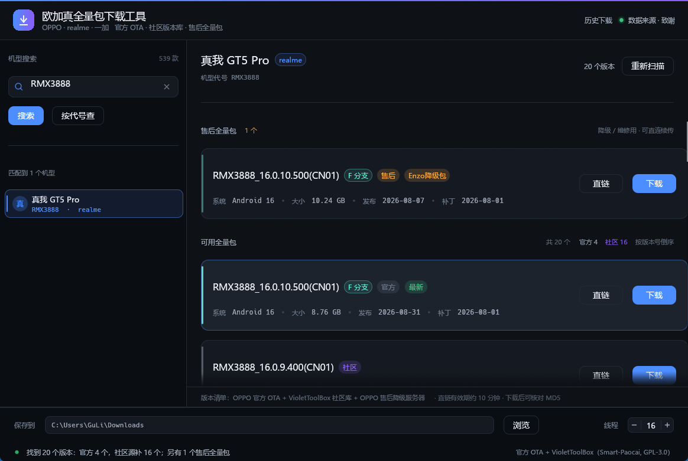

# 欧加真全量包下载工具

> OPPO / 一加 / 真我（合称「欧加真」）官方 OTA 全量包、社区历史版本与售后（降级 / 维修）全量包的检索、下载与校验工具。
> Windows 桌面程序，单文件可执行，无需安装。

[](#许可证)
[](#快速开始)
[](#构建说明)
[](CHANGELOG.md)

---

## 目录

- [功能特性](#功能特性)
- [界面截图](#界面截图)
- [快速开始](#快速开始)
  - [直接运行](#直接运行)
  - [从源码构建](#从源码构建)
- [使用说明](#使用说明)
- [下载与校验](#下载与校验)
- [常见问题](#常见问题)
- [数据来源与致谢](#数据来源与致谢)
- [免责声明](#免责声明)
- [构建说明](#构建说明)
- [许可证](#许可证)

## 功能特性

| 能力 | 说明 |
| --- | --- |
| **机型检索** | 内置 **539 款** OPPO / 一加 / 真我机型的「代号 ↔ 市场名」对照表，支持中文名、英文名、代号的模糊搜索（空格分隔多个关键词，全部命中才算匹配）。也可以直接输入代号（如 `RMX3888`、`PJZ110`）查询内置表之外的机型。 |
| **官方 OTA 全量包** | 与 OPPO 官方 OTA 服务器通信，扫描该机型 **A–Z 全部真实分支**的最新全量包，再用「升级链回溯」把分支扫描拿不到的**中间历史版本**也捞出来。拿到版本号、Android 版本、文件大小、发布日期、安全补丁级别与 MD5。 |
| **社区源版本清单** | 接入 VioletToolBox 社区版本库，补充官方接口已经不再返回的**历史版本**。来源在卡片角标、底栏与「数据来源与致谢」弹窗中均有标注。 |
| **售后（降级 / 维修）全量包** | 查询 ColorOS 官方降级服务器上的售后包，用于**系统降级与售后维修刷机**。这类直链长期有效（不换签），并且支持 Range 断点续传。降级服务器只下发 `ColorOS16.1.0` 这类粗粒度版本号，程序会额外读一次包内的 `META-INF/com/android/metadata`，把真实版本号（如 `RMX3888_16.0.10.500(CN01)`）、补丁级别与发布日期补全到卡片上。 |
| **社区售后包** | 官方降级服务器没给某机型下发包的，可以看社区源有没有收录。社区源的两个通道都会被查：常规版本清单里标注为**降级 / 回退**的条目，以及专门的**售后通道**（一个机型常给三十多个包）。两者都并入同一个「售后全量包」分区（角标「**社区售后**」），并补上文件大小、构建日期与补丁级别；卡片上还会标出它是 **AB 全量包** 还是 **线刷包 OFP**（后者要用 EDL 工具走 9008 刷入）。 |
| **下载历史** | 记住每一次下载的版本、来源、大小、进度、MD5 校验结果与落盘路径。随时从历史里「继续下载 / 重试 / 打开位置 / 删除 / 清空」；**即使关掉程序，只要 `.partstate` 还在，下次打开就能从断点接着下**。历史存在 `%APPDATA%\OujiazhenOtaTool\history.json`，不往下载目录里丢文件。 |
| **多线程分块下载** | 默认 **16 线程**（1–64 可调），**8 MB** 分块，按 HTTP Range 并发拉取；单个分块失败最多重试 **12 次**，签名直链过期会**自动重新签发**后继续。 |
| **断点续传** | 进度以位图形式记录在 `文件名.partstate` 中。随时暂停、关掉程序、下次继续，都只下缺的块，**不重复占用磁盘**。 |
| **MD5 完整性校验** | 下载完成后本地流式计算 MD5（4 MB 缓冲），与服务器给出的 MD5 / `vab_package_hash` 比对。不一致会明确报错，不会当作成功。 |
| **直链复制** | 一键把 CDN 签名直链复制到剪贴板，方便丢给 IDM、aria2 等外部工具。 |
| **界面** | 深色主题、自绘组件、卡片式版本列表、底部常驻下载栏（进度条 / 速度 / 剩余时间 / 暂停继续 / 打开文件夹）与状态栏。 |

## 界面截图



> 截图文件为 `docs/screenshot-main.png`。左侧是机型搜索，中间是按版本号倒序排列的全量包卡片（带分支、来源角标与文件大小），底部常驻下载栏负责保存目录、线程数与下载控制。

## 快速开始

### 直接运行

1. 取得 `OtaTool.exe`（从发布页下载，或按下方「从源码构建」自行构建）。
2. 双击运行。**无需安装，无需管理员权限，不需要额外的 VC++ 运行库**（已静态链接 CRT）。
3. 首次查询会并发扫描 A–Z 分支，通常几秒内出结果。

> 也可以用命令行带机型启动：`OtaTool.exe RMX3888`；
> 或用环境变量 `OTA_TOOL_DIR` 指定默认保存目录。

### 从源码构建

需要 **Windows 10/11 x64** + **Rust stable（MSVC 工具链）** + **Visual Studio Build Tools 的「使用 C++ 的桌面开发」组件**。

```bat
:: 按你的实际安装位置修改下面三个变量
set "RUSTUP_HOME=D:\rust\rustup"
set "CARGO_HOME=D:\rust\cargo"
set "PATH=%CARGO_HOME%\bin;%PATH%"

cd /d C:\path\to\otatool
cargo build --release
```

产物为 `target\release\ota-tool.exe`，对外发布时重命名为 `OtaTool.exe` 即可。详见 [构建说明](#构建说明)。

## 使用说明

### 1. 搜索机型

在左侧「机型搜索」输入框中输入中文名、英文名或代号，例如 `GT5 Pro`、`Find X8`、`RMX3888`，回车或点「搜索」。

- 匹配结果按相关度排序，并显示「匹配到 N 个机型」。
- 已知代号时可以直接点「按代号查」，跳过内置名单直接去服务器问。

### 2. 查询版本

选中一个机型后点「重新扫描」，程序会：

1. 并发扫描 A–Z 全部真实分支，取每个分支的当前最新包；
2. 同时沿升级链回溯，补出分支扫描拿不到的中间历史版本；
3. 并行请求社区源，合并去重后按版本号倒序排列。

状态栏会汇总结果，例如「找到 N 个版本：官方 X 个，社区源补 Y 个」。

### 3. 选择版本

版本卡片上给出：**分支**（如 `A.31`）、**最新**标记、Android 版本、文件大小、发布日期、安全补丁级别，以及**来源角标**（官方 / 社区 / 售后 / 社区售后）。社区源中已失效的旧链接会被标为「链接已失效」。

### 4. 下载或复制直链

- **下载**：点卡片上的「下载」，底栏出现进度条、速度、剩余时间；可随时「暂停」，「继续下载」会从断点接着下。
- **直链**：点「直链」把 CDN 签名地址复制到剪贴板（约 10 分钟有效）。
- **保存位置**：底栏「保存到」可改目录，默认是当前用户的「下载」文件夹。
- **线程数**：底栏「线程」可调 1–64，默认 16。
- **打开文件夹**：下载完成后一键在资源管理器中定位文件（路径同时复制到剪贴板；定位失败会在状态栏给出具体错误码，而不是毫无反应）。

### 5. 历史下载

点顶栏右上角的「**历史下载**」：

- 顶部统计「N 条记录 · 可续传 X · 已完成 Y」，右侧「重新扫描」会重新读取磁盘，把被外部删掉的文件、或仍然存在的 `.partstate` 重新核对一遍。
- 每条记录显示：版本号、状态角标（下载中 / 已暂停 / 已完成 / 失败）、来源角标（官方 / 社区 / 售后）、MD5 校验角标、机型与代号、大小与更新日期、进度条与落盘路径。
- 右侧操作：「继续下载 / 重试」「打开位置」「删除」；底部「清空记录」。
- 状态判定是**按磁盘实况**推出来的，不是只信记录：文件还在且大小够了就是已完成；只有 `.partstate` 就是可续传；文件被删了就是失败。

> 文件名规则：普通包是 `<版本号>.zip`；售后包是 `<版本号>_售后.zip`。售后包与官方包的 `version_name` 可能完全相同（都是 `RMX3888_16.0.10.500(CN01)`）但体积不同，加后缀可以让两者各自使用自己的进度位图，不会互相串块。

### 售后全量包（降级 / 维修）

售后包在列表中单独标识：官方降级服务器下发的是「**售后**」角标，社区源收录的是「**社区售后**」角标。它们与普通全量包的区别：

| | 普通官方全量包 | 售后（降级 / 维修）包 |
| --- | --- | --- |
| 用途 | 常规系统升级 / 同版本重装 | 系统**降级**、售后维修刷机 |
| 服务器 | OTA 服务器（`component-ota-cn.allawntech.com`） | 降级服务器（`downgrade.coloros.com`） |
| 直链有效期 | 约 10 分钟，过期需重新签发 | **长期有效，不换签** |
| 加密方式 | AES-256-CTR + RSA-OAEP(SHA1) | AES-256-GCM + RSA-OAEP(SHA1) |
| 校验 | MD5 / `vab_package_hash` | 服务器给出的哈希 |
| 版本号 | 服务器直接下发 | 服务器只给大版本号，程序读包内 metadata 补全 |
| 落盘文件名 | `<版本号>.zip` | `<版本号>_售后.zip` |
| 角标 | 官方 / 社区 | 售后（官方降级服务器） / 社区售后（VioletToolBox 收录） |
| 封装形态 | 一律 A/B 全量包 | 多数是 A/B 全量包；社区售后里另有一批 **OFP / EDL 线刷包**，卡片上标「线刷包 OFP」 |

> 降级会**清空手机数据**，操作前务必备份。是否可用、能否跨大版本降级，取决于你机型的实际策略，本工具只负责把包找出来。
>
> 售后分区排在版本列表**最前面**，并且**默认只展开 2 张**：官方售后包通常只有 1–2 个，但社区售后通道一个机型能给三十多个（实测 `RMX3706` 有 34 个），全铺开会把下面「可用全量包」整段推出屏幕。分区标题右侧有「展开全部 N」（展开后变「收起」），需要翻全部售后包时点它。
>
> **官方售后与社区售后在同一个分区里，官方在前、社区在后**：官方直链长期有效且带 MD5 校验，社区直链是第三方站点当场签发的（约 10 分钟），先给用户更好的那个。两者**不会互相去重** —— 官方卡的版本号读自包内 `version_name`，社区写的是它自己的版本名，字符串对不上，硬比反而会把同一个包列两遍。
>
> 两种售后包都会补上真实版本号、文件大小、发布日期与补丁级别：官方那张靠包内 metadata（版本号也从这里来），社区那张先换直链再用同样的方法读首部。社区里有部分包把 `security_patch` 写成 `2088-08-05` 这种虚构值，程序会按年份做合理性判断并丢弃，宁可不显示也不显示假日期。
>
> 不是每台机器都有售后包：官方确实没给某机型准备降级包、社区源也没有收录时，分区会写明「该机型的官方数据里没有售后全量包」；降级服务器抽风（约 40% 的请求会返回 500）时会提示「售后包这次没查到，可点重新扫描重试」，而不是留下一片空白。

## 下载与校验

这一节解释一个常见疑问：**多线程分块 + 断点续传，会不会让文件“拼歪”，导致 MD5 校验失败？**

答案是**不会**，原因有三层：

**1. 文件在下载开始前就被预分配成最终大小。**
调用 `set_len(total)` 一次性占位，此后所有写入都是**覆盖式**的，不存在「越写越大」的追加语义。

**2. 每个分块写入的是它自己的绝对偏移，与线程调度无关。**
第 `i` 个分块永远对应区间 `[i × 8 MB, min((i+1) × 8 MB, total))`。工作线程从共享的原子计数器里抢块编号，抢到几号就 `seek(块起点)` 再 `write_all`——**块编号与线程编号没有绑定关系**，谁抢到都一样。所以线程数从 1 调到 64，落盘结果逐字节相同。

**3. 断点续传只做「跳过」，不做「移动」。**
`.partstate` 里记的是「哪些块已经是 1」。续传时这些块被直接跳过，剩下的块仍然写到各自原来的偏移上。整个过程中没有任何数据被搬移、拼接或重排。

因此，**文件内容只由「哪一段字节属于哪个偏移」决定，而不由「谁在什么时候写的」决定**。MD5 是整份文件内容的函数，所以：

- 单线程下完、16 线程下完、下到一半关了程序第二天再续——三种情况得到的文件**完全相同**，MD5 也完全相同。
- 校验时程序用 4 MB 缓冲把整份文件从头流式读一遍，与服务器给出的 MD5（不区分大小写）比对。
- **不一致就报错**：「MD5 校验不符（得到 …），文件可能损坏，建议删除后重新下载」，不会把坏文件当成功交付。
- 校验结束后 `.partstate` 会被删除，无论成败。

> 补充：下载过程中程序每 5 秒（以及暂停后 100 ms 内）把位图落盘一次，所以即使强制断电/杀进程，最多丢失最后几秒的进度，重新打开仍能续传。

## 常见问题

- **为什么很多旧版本在官方列表里看不到？** 分支扫描只能拿到每个分支的**当前最新**包；升级链回溯能补出**中间版本**；更早的版本官方接口已经不再返回，只能靠社区源。详见 [docs/FAQ.md](docs/FAQ.md#为什么很多旧版本在官方列表里看不到)。
- **直链为什么只有 10 分钟？** 它是 CDN 的签名地址，超过有效期会被拒绝访问；重新点「直链」或重新下载即可换一张新的签名。详见 [docs/FAQ.md](docs/FAQ.md#直链为什么只有-10-分钟)。
- **下载中断了怎么办？** 直接点「继续下载」，已完成的块会被跳过。详见 [docs/FAQ.md](docs/FAQ.md#下载中断了怎么办)。
- **MD5 对不上怎么办？** 先续传重下缺失块；仍不符则删除文件重新下载，并检查磁盘/内存。详见 [docs/FAQ.md](docs/FAQ.md#md5-对不上怎么办)。
- **售后包和普通全量包有什么区别？** 见 [使用说明 · 售后全量包](#售后全量包降级--维修)与 [docs/FAQ.md](docs/FAQ.md#售后包与普通全量包的区别)。
- **为什么我的机型没有售后包？** 分「官方确实没有」和「这次没查通」两种情况，界面会分别提示。详见 [docs/FAQ.md](docs/FAQ.md#为什么有的机型没有售后包)。
- **「社区售后」和「售后」有什么区别？** 前者由 VioletToolBox 收录、直链 10 分钟过期；后者由 ColorOS 官方降级服务器签发、直链长期有效。两者都在同一个售后分区里。详见 [docs/FAQ.md](docs/FAQ.md#社区售后包与官方售后包有什么区别)。
- **社区售后卡上的日期为什么是「未知」？** 社区源只给版本名，大小与日期靠程序换取直链后读 ZIP 首部补齐；个别包首部读不到时这几栏会留空，但不影响下载。
- **关掉程序后还能接着下吗？** 能。点顶栏「历史下载」，找到那条记录点「继续下载」，已完成的块会被跳过。见 [使用说明 · 历史下载](#5-历史下载)。
- **为什么售后卡显示的是真实版本号，而不是 `ColorOS16.1.0`？** 程序额外读了包内 metadata 把版本号补全了，详见 [docs/ARCHITECTURE.md](docs/ARCHITECTURE.md#售后包的版本号为什么要额外读-zip)。
- **杀毒软件报毒？是否需要管理员权限？** 见 [docs/FAQ.md](docs/FAQ.md#杀毒软件报毒怎么办) 与 [docs/FAQ.md](docs/FAQ.md#需要管理员权限吗)。

更完整的问题列表请见 **[docs/FAQ.md](docs/FAQ.md)**。

## 数据来源与致谢

本工具的数据来自三条互相补充的通道。**没有社区源，很多老版本根本找不到**；**没有售后通道，就下不到降级 / 维修用的包**。所以这里把来源与许可写清楚。

### 1. 官方 OTA 服务器

- **来源**：OPPO / 一加 / 真我 官方 OTA 服务器
- **地址**：`component-ota-cn.allawntech.com`（`/update/v6`）
- **提供**：各分支**当前最新**版本号、Android 版本、文件大小、发布日期、安全补丁级别、MD5 / `vab_package_hash`
- **用途**：主数据源。全量包的版权归**原厂**所有，本工具只做检索与下载。

### 2. 社区源 VioletToolBox

- **项目**：VioletToolBox
- **作者**：**Smart-Paocai**
- **许可证**：**GNU GPL v3.0**
- **代码仓库**：<https://github.com/Smart-Paocai/VioletToolBox>
- **数据服务**：<https://violettool.top>
- **提供**：官方接口已经不再返回的**历史版本清单**，以及对应的下载链接；另外它的**售后通道**（`afterSales`）里有一批降级 / 线刷固件，一个机型常有三十多个。这两处都会作为「社区售后包」并入售后分区

**声明**：本程序**只调用 VioletToolBox 的公开 HTTP 接口**（无需登录、无需鉴权），**未复制、未修改、未分发其源代码**，也未把其代码以任何形式静态或动态链接进本程序。数据来源与作者信息在程序内的「数据来源 · 致谢」弹窗、版本卡片来源角标、底部状态栏三处均有标明。社区源的旧版本链接可能已经失效，卡片上会标记「链接已失效」。

### 3. 售后（降级 / 维修）全量包

- **来源**：ColorOS 官方降级服务器
- **地址**：`downgrade.coloros.com`（`/downgrade/query-v3`）
- **提供**：可用于**系统降级与售后维修刷机**的完整固件包，直链长期有效
- **用途**：辅助通道。包的版权同样归**原厂**所有。

这一路只覆盖**官方允许降级**的那一两个包。官方没下发的机型，由社区源的两条售后路径兜底（见上一节），它们在界面上同属「售后全量包」分区、角标统一为「社区售后」。

与官方 OTA 通道一样，本工具只做**协议层的查询与下载**，不镜像、不分发任何固件本体。

### 4. 其他

- GUI 框架：[egui](https://github.com/emilk/egui) / [eframe](https://github.com/emilk/egui/tree/master/crates/eframe)（MIT / Apache-2.0）
- HTTP：[ureq](https://github.com/algesten/ureq)（MIT / Apache-2.0）
- 密码学：[RustCrypto](https://github.com/RustCrypto) 系列 crate（MIT / Apache-2.0）

## 免责声明

- 本工具**仅供个人学习与设备维护使用**，请勿用于任何商业用途或非法用途。
- 所有固件、软件包的**版权归原厂（OPPO / 一加 / 真我）所有**，本工具不提供、不分发任何固件本体，只是代为查询与下载。
- 刷机、降级、修复均存在**变砖、数据丢失、保修失效**的风险，**风险自负**。操作前请自行备份重要数据并确认机型与版本匹配。
- 因使用本工具造成的任何直接或间接损失，作者不承担任何责任。
- 本工具与非官方项目，与 OPPO、一加、真我及其关联公司**没有任何隶属或背书关系**。

## 构建说明

### 环境要求

| 项目 | 要求 |
| --- | --- |
| 系统 | Windows 10 / 11 x64 |
| 工具链 | Rust stable，**MSVC** 目标（`x86_64-pc-windows-msvc`） |
| C++ 生成工具 | **Visual Studio Build Tools** 的「使用 C++ 的桌面开发」工作负载（提供 MSVC 链接器与 Windows SDK） |

> 没有 MSVC 链接器时构建会在链接阶段报 `link.exe not found`。安装 Build Tools 后重新打开终端即可。

### 设置环境变量

构建前把 `RUSTUP_HOME`、`CARGO_HOME`、`PATH` 指向你的实际安装位置：

```bat
set "RUSTUP_HOME=D:\rust\rustup"
set "CARGO_HOME=D:\rust\cargo"
set "PATH=%CARGO_HOME%\bin;%PATH%"

rustc --version
cargo --version
```

### 构建

```bat
cd /d C:\path\to\otatool
cargo build --release
```

产物：`target\release\ota-tool.exe`（发布时重命名为 `OtaTool.exe`）。

### 构建产物为什么这么小

`Cargo.toml` 的 `[profile.release]` 已经做了体积优化：`opt-level = "z"`、`lto = true`、`codegen-units = 1`、`panic = "abort"`、`strip = true`。

`.cargo/config.toml` 里设置了 `-C target-feature=+crt-static`，**静态链接 C 运行库**，因此产物是单个 exe，目标机器不需要安装 VC++ 运行库。

### 目录结构

```
otatool/
├── Cargo.toml
├── Cargo.lock
├── .cargo/config.toml      # 静态 CRT
├── LICENSE                 # GPL-3.0 全文
├── CHANGELOG.md
├── src/
│   ├── main.rs             # 窗口与面板布局
│   ├── models.rs           # 539 款机型代号 / 市场名表
│   ├── core/               # 无 UI 依赖的核心逻辑
│   │   ├── search.rs       # 机型模糊搜索
│   │   ├── ota.rs          # 官方 OTA 协议 + 数据模型
│   │   ├── violet.rs       # 社区源客户端（版本清单 + 社区售后包）
│   │   ├── downgrade.rs    # 售后降级服务器客户端
│   │   ├── meta.rs         # 读 ZIP 首部 metadata（补版本号 / 大小 / 日期）
│   │   ├── download.rs     # 多线程分块下载 / 续传 / 校验
│   │   ├── history.rs      # 下载历史记录
│   │   └── theme.rs        # 深色主题与自绘组件
│   └── app/                # egui 界面层
│       ├── state.rs        # 应用状态机
│       ├── format.rs       # 数值 / 日期格式化
│       ├── shell.rs        # 资源管理器定位（COM STA 线程）
│       └── views/          # topbar / sidebar / packages / bottom / history / about
└── docs/
    ├── ARCHITECTURE.md
    ├── FAQ.md
    └── screenshot-main.png
```

模块划分与数据流的详细说明见 **[docs/ARCHITECTURE.md](docs/ARCHITECTURE.md)**。

## 许可证

本项目以 **GNU General Public License v3.0** 发布，全文见 [LICENSE](LICENSE)。

```
Copyright (C) 2026  OtaTool contributors

This program is free software: you can redistribute it and/or modify
it under the terms of the GNU General Public License as published by
the Free Software Foundation, either version 3 of the License, or
(at your option) any later version.

This program is distributed in the hope that it will be useful,
but WITHOUT ANY WARRANTY; without even the implied warranty of
MERCHANTABILITY or FITNESS FOR A PARTICULAR PURPOSE.  See the
GNU General Public License for more details.

You should have received a copy of the GNU General Public License
along with this program.  If not, see <https://www.gnu.org/licenses/>.
```

本程序使用了第三方数据服务与开源库，逐条来源与许可说明见 [数据来源与致谢](#数据来源与致谢)。
